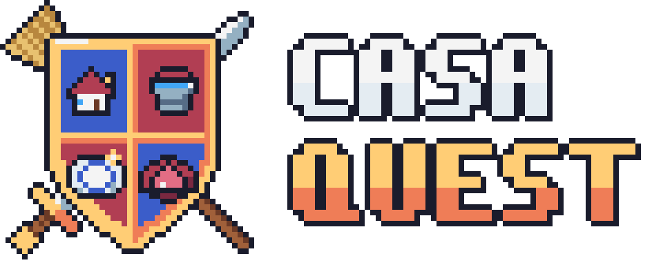
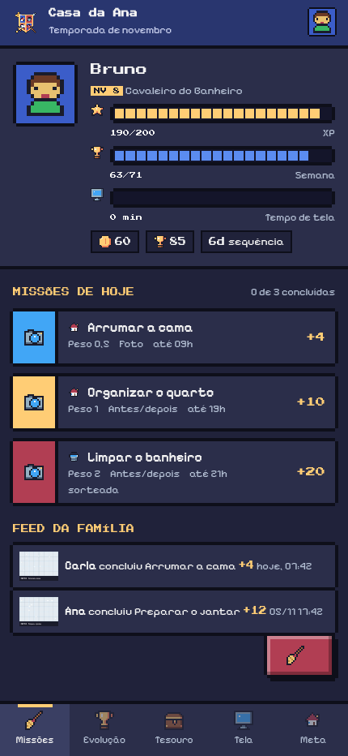

  <picture>
    <source media="(prefers-color-scheme: dark)" srcset="assets/brand/png/casa-quest-logo-horizontal-fundo-escuro.png">
    
  </picture>

<h3 align="center">A casa é a guilda. A rotina é a missão.</h3>

  <a href="prototipo/index.html">Protótipo</a> ·
  <a href="docs/ideia.md">Conceito completo</a> ·
  <a href="design-system/project/README.md">Design system</a>

---

**CasaQuest** transforma as tarefas da casa em um jogo cooperativo: cada atividade registrada com foto vira ponto, cada ponto vira evolução, recompensa e tempo de computador. O objetivo não é criar mais uma lista de tarefas, e sim tornar visível o trabalho que já existe em casa — e dividi-lo de forma justa.

## O problema

A divisão das tarefas domésticas é invisível e desigual. Quem faz mais se sente sobrecarregado e pouco reconhecido; quem cobra se desgasta; filhos veem tarefa como castigo; e o tempo de tela vira negociação caso a caso.

## A solução

| Pilar | O que faz |
|---|---|
| **Registrar e comprovar** | Cada missão tem peso, prazo e prova visual. A família combina as regras antes; o app aplica. |
| **Competir e recompensar** | Pontos viram XP, evolução semanal, ranking por equipe, níveis, temporadas e prêmios em três horizontes. |
| **Liberar tempo de tela** | Créditos viram horas de computador. Em vez de proibir, o app negocia o tempo com o esforço feito. |

## O ciclo do jogo

1. A família cadastra as missões e seus pesos.
2. Alguém conclui e registra com foto — simples ou antes/depois.
3. Outra pessoa aprova. Ninguém aprova o próprio registro.
4. Os pontos alimentam três contadores: **XP** (nível pessoal), **temporada** (evolução e ranking por equipe) e **créditos** (saldo para gastar).
5. Créditos viram recompensas do Tesouro ou tempo de computador.

## O que já está no protótipo

Dashboard da família, registro com foto, cálculo `peso × 10 × evidência × qualidade`, evolução semanal, ranking por equipe, meta coletiva, Tesouro, mesada, sorteio balanceado de missões, modo dupla e simulação de bloqueio do computador. Tudo com dados fictícios no `localStorage`, sem backend.

Para abrir: baixe o repositório e abra [`prototipo/index.html`](prototipo/index.html) no navegador. O botão **Abrir só o app** (ou o endereço com `#app`) mostra a versão de celular.

## Identidade visual

Pixel art 8 bits com brasão de RPG: a família como guilda, a vassoura e a espada cruzadas, o d20 do sorteio. A interface usa contornos de 4 px, cantos em degrau e nenhuma curva — e celebra o ganho, nunca pune.

| Cor | Hex | Uso |
|---|---|---|
| Contorno | `#1a1c2c` | Molduras e sombras duras |
| Azul heráldico | `#3b5dc9` | Estrutura, temporada, avatar |
| Vermelho heráldico | `#b13e53` | Missão pesada, d20, alerta |
| Ouro | `#ffcd75` | Marca, XP, botão primário |
| Ciano | `#41a6f6` | Tempo de tela, missão leve |
| Pergaminho | `#f2e8d5` | Tema Dia |

**Tipografia:** Press Start 2P nos títulos e números; Pixelify Sans nos textos. Temas **Noite** (padrão) e **Dia**, ambos com a mesma paleta.

## Status

Protótipo navegável feito para o **Hackathon IBM 2026**, em 40 minutos. O foco é demonstrar o fluxo de ponta a ponta — login, backend, banco e bloqueio real de computador estão fora do escopo. Uma versão Flutter do app está em desenvolvimento na branch `feat/app-flutter`.
