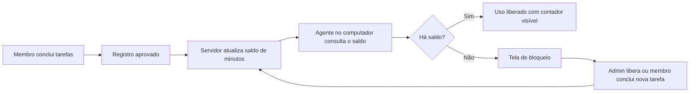
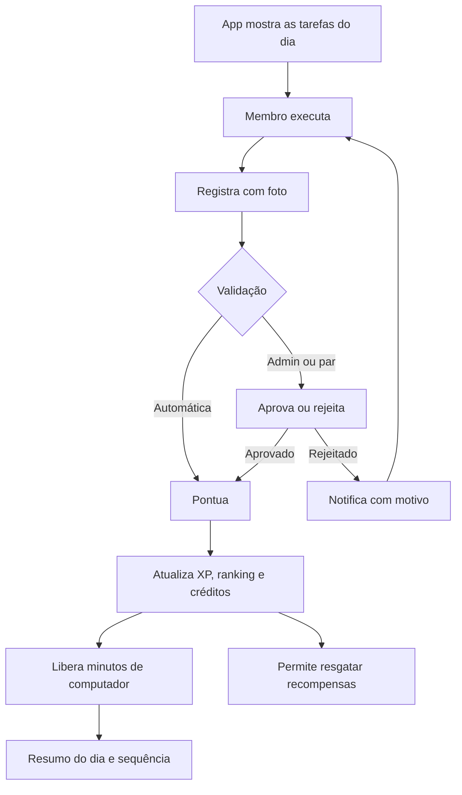
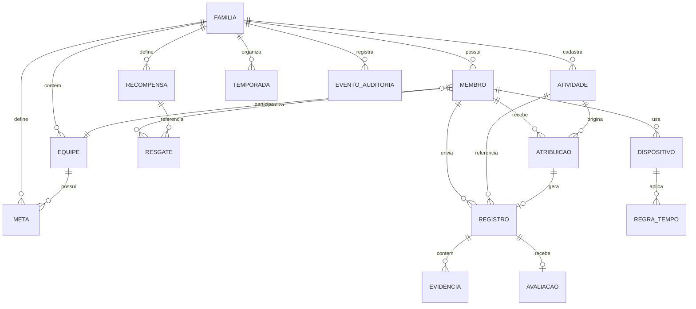
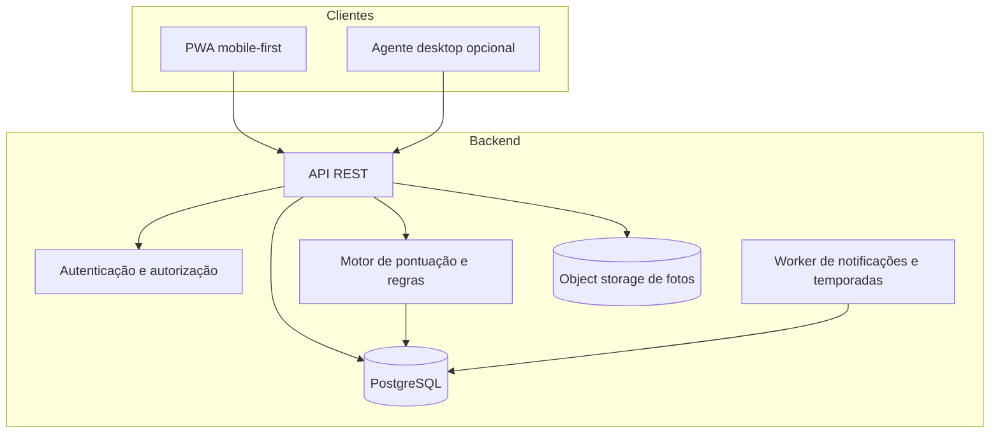

# Lar em Jogo — Conceito do Produto

> **Pitch:** um aplicativo que transforma as tarefas da casa em um jogo cooperativo e competitivo: cada atividade registrada com foto vira ponto, cada ponto vira ranking, recompensa e tempo de computador.

**Status:** conceito inicial para o hackathon IBM 2026
**Última atualização:** 06/11/2026
**Nome:** provisório ("Lar em Jogo")

---

## Sumário

1. [Visão geral](#1-visão-geral)
2. [Problema e oportunidade](#2-problema-e-oportunidade)
3. [Público-alvo e personas](#3-público-alvo-e-personas)
4. [Conceito e princípios](#4-conceito-e-princípios)
5. [Funcionalidades](#5-funcionalidades)
6. [Jornada do usuário](#6-jornada-do-usuário)
7. [Regras de negócio](#7-regras-de-negócio)
8. [Modelo de dados conceitual](#8-modelo-de-dados-conceitual)
9. [Requisitos](#9-requisitos)
10. [Arquitetura proposta](#10-arquitetura-proposta)
11. [MVP do hackathon](#11-mvp-do-hackathon)
12. [Diferenciais](#12-diferenciais)
13. [Riscos e mitigações](#13-riscos-e-mitigações)
14. [Métricas de sucesso](#14-métricas-de-sucesso)
15. [Questões em aberto](#15-questões-em-aberto)
16. [Glossário](#16-glossário)

---

## 1. Visão geral

O **Lar em Jogo** é um aplicativo de gestão gamificada das tarefas domésticas para famílias e casais. Ele registra as atividades da rotina, comprova a execução com fotos, converte o esforço em pontos e usa esses pontos para alimentar três coisas ao mesmo tempo:

1. **Competição saudável** — ranking individual e por equipe, níveis e conquistas.
2. **Recompensas** — de curto, médio e longo prazo, definidas pelo administrador da família.
3. **Tempo de tela** — liberação de horas no computador conforme as tarefas são concluídas.

A proposta não é criar mais uma lista de tarefas, e sim tornar visível o trabalho que já existe em casa, distribuir esse trabalho de forma justa e transformar a rotina em um jogo com regras claras.

### Os três pilares

| Pilar | O que faz | Por que importa |
|---|---|---|
| **Registrar e comprovar** | Catálogo de atividades com peso, foto simples ou antes/depois, aprovação | Dá evidência e visibilidade ao esforço de cada um |
| **Competir e recompensar** | Pontos, ranking, níveis, temporadas, prêmios em três horizontes | Cria motivação de curto prazo e metas de longo prazo |
| **Liberar tempo de tela** | Conversão de pontos em horas de computador, com bloqueio e desbloqueio | Conecta a recompensa ao comportamento que se quer incentivar |

### O que o produto não é

- Não é um aplicativo de vigilância ou controle parental invasivo.
- Não é uma planilha de tarefas com tema de jogo.
- Não é um ranking público entre famílias.
- Não é um sistema punitivo: o foco é reconhecer esforço, não penalizar.

---

## 2. Problema e oportunidade

### Dores atuais

| Dor | Consequência | Como o produto atua |
|---|---|---|
| Distribuição desigual das tarefas | Sobrecarga de uma pessoa e ressentimento | Registro visível, pesos e divisão balanceada |
| Falta de reconhecimento | Sensação de que "ninguém vê o que eu faço" | Pontos, feed e ranking familiar |
| Cobrança repetitiva | Desgaste diário e conflitos | Regras combinadas antes, com o app como árbitro |
| Tempo de tela sem critério | Negociação caso a caso e culpa | Horas conquistadas por tarefas, com limite claro |
| Filhos desmotivados | Tarefa vista como castigo | Gamificação, metas coletivas e recompensas reais |
| Casais sem acordo explícito | Um faz mais e o outro não percebe | Modo dupla com revezamento e avaliação cruzada |

### Oportunidade

- A câmera do celular já é usada para registrar tudo; ela pode ser a prova da tarefa.
- Controles parentais existem, mas normalmente são desconectados das responsabilidades da casa.
- Gamificação funciona bem quando a recompensa é significativa e a regra é justa.
- O tema "divisão de tarefas domésticas" é universal: serve para famílias, casais, repúblicas e até equipes pequenas.

---

## 3. Público-alvo e personas

### Público primário

- **Famílias com crianças e adolescentes** (aproximadamente 6 a 17 anos), com pai, mãe ou responsável como administrador.
- **Casais** que querem dividir tarefas e criar um acordo visível.

### Público secundário

- Famílias monoparentais com vários filhos.
- Repúblicas e moradias compartilhadas.
- Grupos pequenos que convivem e dividem responsabilidades.

### Personas

| Persona | Descrição | Necessidade principal |
|---|---|---|
| **Admin (pai/mãe/responsável)** | Define atividades, pesos, recompensas e aprova registros | Ter visão do todo e reduzir a cobrança manual |
| **Membro executor** | Filho, filha ou parceiro que realiza as tarefas | Saber o que fazer, ganhar reconhecimento e trocar por recompensas |
| **Par avaliador** | Em duplas, valida o trabalho do outro | Garantir justiça sem depender só do admin |
| **Equipe** | Grupo de membros com uma meta coletiva | Cooperar para conquistar um prêmio maior |

### Papéis no sistema

| Papel | Permissões |
|---|---|
| **Admin** | Criar família, cadastrar atividades e pesos, definir recompensas, aprovar ou contestar registros, liberar tempo de computador, encerrar temporadas |
| **Membro** | Registrar atividades, enviar fotos, resgatar recompensas, consultar ranking e extrato |
| **Par avaliador** | Avaliar registros do outro membro da dupla, quando habilitado |
| **Equipe** | Papel coletivo; não é usuário, é um agrupamento de membros com meta própria |

> Um mesmo usuário pode ser admin de uma família e membro de outra? Para o MVP, **não**. Cada usuário pertence a uma família por vez.

---

## 4. Conceito e princípios

### Princípios de design

1. **Justiça por peso** — tarefa pesada vale mais; tarefa leve vale menos; a soma por pessoa precisa ficar equilibrada.
2. **Cooperação além da competição** — o ranking individual motiva, mas as metas coletivas evitam que o jogo vire briga.
3. **Prova visual, não vigilância** — a foto comprova a tarefa e gera orgulho; não serve para monitorar a pessoa.
4. **Recompensa em três horizontes** — curto prazo mantém o hábito, médio prazo renova o interesse, longo prazo dá sentido à rotina.
5. **Tempo de tela como moeda** — em vez de proibir, o app negocia: o computador libera horas conforme o esforço.
6. **Privacidade por padrão** — fotos e ranking ficam restritos à família; nada é público.
7. **Leveza, não punição** — falhar não deve gerar dívida ou humilhação; deve gerar redistribuição e nova chance.
8. **Regra combinada antes** — o admin define pesos e prêmios com antecedência; o app aplica, não improvisa.

### Os três contadores do jogo

Para evitar confusão entre "pontos que sobem no ranking" e "pontos que se gastam", o produto separa três contadores:

| Contador | O que mede | Reseta? | Para que serve |
|---|---|---|---|
| **XP** | Experiência acumulada | Nunca | Nível pessoal do membro |
| **Pontos de temporada** | Desempenho na temporada atual | A cada temporada | Ranking individual e por equipe |
| **Créditos** | Saldo disponível para gastar | Não (pode ter validade configurável) | Resgate de recompensas e horas de computador |

Cada registro aprovado gera o mesmo valor nos três contadores. Gastar créditos **não reduz** XP nem pontos de temporada — ou seja, trocar uma recompensa não faz a pessoa cair no ranking.

---

## 5. Funcionalidades

### 5.1 Registro e validação de atividades

#### Catálogo de atividades

O admin cadastra as atividades da casa com:

| Campo | Descrição | Exemplo |
|---|---|---|
| **Nome** | O que precisa ser feito | "Limpar o banheiro" |
| **Peso** | Esforço relativo da tarefa | `2,0` |
| **Frequência** | Diária, semanal, quinzenal ou avulsa | Diária |
| **Evidência exigida** | Nenhuma, só depois ou antes/depois | Antes/depois |
| **Responsável** | Membro fixo, dupla, revezamento ou sorteio | Sorteio |
| **Prazo** | Horário limite do dia | 21h |
| **Ativo** | Se ainda entra na rotina | Sim |

#### Exemplo de pesos

| Atividade | Peso | Pontos base | Evidência |
|---|---:|---:|---|
| Arrumar a cama | 0,5 | 5 | Só depois |
| Tirar o lixo | 0,5 | 5 | Só depois |
| Lavar a louça | 1,0 | 10 | Só depois |
| Organizar o quarto | 1,0 | 10 | Antes/depois |
| Limpar o banheiro | 2,0 | 20 | Antes/depois |
| Limpeza pesada da casa | 3,0 | 30 | Antes/depois |

#### Fórmula de pontuação

```
pontos_base = peso × 10
pontos_finais = pontos_base × multiplicador_evidência × multiplicador_qualidade
```

| Multiplicador | Valor | Quando se aplica |
|---|---:|---|
| Evidência antes/depois | 1,0 | Foto do antes e do depois |
| Evidência só depois | 0,8 | Apenas uma foto do resultado |
| Sem foto (se permitido) | 0,5 | Atividades de baixo risco |
| Qualidade | 0,8 a 1,2 | Ajuste opcional do avaliador, com justificativa; padrão 1,0 |

O resultado é arredondado para o meio ponto mais próximo. O ajuste de qualidade é opcional e deve ser usado com moderação, para não virar fonte de disputa.

#### Registro com foto

- O membro toca na atividade do dia e registra a execução.
- Pode enviar **uma foto do resultado** ou **duas fotos (antes e depois)**.
- O app adiciona data, hora e autor ao registro.
- O registro entra em um dos estados: `pendente`, `aprovado`, `rejeitado` ou `contestado`.
- O feed da família mostra os registros recentes, com foto, pontos e autor.

#### Validação

| Modo | Quem valida | Quando usar |
|---|---|---|
| **Automático** | O próprio sistema | Atividades de baixo peso, sem evidência |
| **Admin** | Pai, mãe ou responsável | Atividades de maior peso ou que exigem critério |
| **Avaliação cruzada** | O outro membro da dupla | Casais e duplas de filhos |
| **Auditoria** | Admin, por amostragem | Verificação periódica de registros aprovados automaticamente |

#### Contestação

- O membro pode contestar uma rejeição, anexando uma justificativa.
- O admin decide em última instância.
- Toda decisão fica registrada em um histórico de auditoria.

### 5.2 Competição, ranking e recompensas

#### Ranking

- **Individual:** dentro da família, por pontos de temporada.
- **Por equipe:** soma dos pontos dos membros da equipe.
- **Temporadas:** ciclo configurável (semanal, mensal ou por meta), para não cristalizar o resultado.
- **Critérios de desempate:** mais tarefas concluídas, depois maior soma de pesos, depois registro mais antigo.

O ranking é **privado da família**. Não existe ranking global nem comparação entre casas.

#### Níveis e conquistas

- XP acumulado define o nível pessoal (ex.: a cada 200 XP sobe um nível).
- O nível é uma medida de progresso **contra si mesmo**, não contra os outros.
- Conquistas (badges) reconhecem comportamentos específicos:
  - "Sequência de 7 dias"
  - "Nunca mais esqueci a cama"
  - "Primeira limpeza pesada"
  - "Ajudante do mês"
  - "Parceiro justo" (avaliou sem conflito)

#### Recompensas em três horizontes

| Horizonte | Exemplos | Custo aproximado | Quem define |
|---|---|---|---|
| **Curto prazo** (diário/semanal) | 30 min extras de tela, escolher o filme, sobremesa especial, dormir 15 min mais tarde | 10 a 50 créditos | Admin |
| **Médio prazo** (mensal) | Passeio no parque, jogo, dinheiro de mesada, dia sem tarefas | 100 a 400 créditos | Admin |
| **Longo prazo** (trimestral/anual) | Viagem, parque temático, console, festa com amigos | 1.000+ créditos ou meta coletiva | Admin, com participação da família |

Regras importantes:

- A recompensa é definida **antes** da temporada começar; mudanças valem para o próximo ciclo.
- O resgate só é permitido se o saldo de créditos for suficiente.
- Recompensas de longo prazo podem ser **metas coletivas**: todos precisam contribuir com um mínimo para desbloquear.
- O admin pode limitar estoque (ex.: "2 resgates de sobremesa por semana").

#### Metas coletivas

Exemplo: os três filhos somam 5.000 pontos em 90 dias e ganham uma viagem.

- A meta tem um alvo de pontos e uma data limite.
- Cada membro precisa atingir uma **contribuição mínima** (ex.: 20% do alvo) para que o prêmio seja liberado.
- A barra de progresso mostra quanto falta e quanto cada um já contribuiu.
- Isso evita que uma pessoa carregue a equipe sozinha e transforma o ranking em cooperação.

#### Anti-toxicidade

- Temporadas curtas resetam o ranking.
- Níveis pessoais reconhecem progresso independentemente da posição.
- Metas coletivas equilibram a competição.
- O admin pode ocultar o ranking de crianças menores.
- O app nunca expõe o desempenho para fora da família.
- Rejeições exigem motivo; rejeições repetidas e injustificadas são sinalizadas ao admin.

### 5.3 Atribuição justa: duplas, revezamento e sorteio

#### Modo dupla (casais e pares)

- **Revezamento:** um dia uma pessoa faz, no outro dia a outra; ou uma semana cada.
- **Divisão por categoria:** uma pessoa fica com cozinha, a outra com banheiro, por exemplo.
- **Avaliação cruzada:** quem não executou valida o trabalho do outro.
- **Conflito de interesse:** ninguém avalia o próprio registro.
- **Impasse:** se o avaliador rejeitar e o executor contestar, o admin decide.

#### Não cumprimento

- A tarefa não feita pode ser:
  - redistribuída para o outro membro, que ganha os pontos; ou
  - movida para a fila de pendências do dia seguinte; ou
  - marcada como justificada pelo admin, sem perda.
- O membro que não cumpriu perde a sequência (streak) e deixa de ganhar os pontos daquela atividade.
- O produto **não** cria saldo negativo nem dívida.

#### Sorteio balanceado

O sorteio distribui as atividades da semana (ou do dia) entre os membros, equilibrando o peso total.

Algoritmo proposto:

1. Listar as atividades do período com seus pesos.
2. Ordenar da maior para a menor.
3. Para cada atividade, atribuir ao membro elegível com **menor peso acumulado**.
4. Considerar restrições: idade, disponibilidade, alergias, tarefas que exigem adulto.
5. Se a diferença entre o maior e o menor acumulado passar de um limite (ex.: 15%), tentar trocas para reequilibrar.
6. Publicar o resultado com data, seed e possibilidade de o admin trocar com justificativa.

Exemplo de resultado:

| Membro | Atividades | Peso total |
|---|---|---:|
| Ana | Banheiro + lixo | 2,5 |
| Bruno | Louça + cama | 1,5 |
| Carla | Quarto + louça | 2,0 |

O objetivo não é igualdade matemática perfeita, e sim **ausência de sobrecarga sistemática**.

### 5.4 Controle de tempo de computador

#### Conceito

O tempo de computador é a recompensa mais concreta do jogo: as tarefas do dia liberam **blocos de minutos**, e o computador só permanece desbloqueado enquanto houver saldo.

```
minutos_disponíveis = (créditos_convertidos × fator) + bônus - tempo_utilizado
```

O fator é configurável pelo admin. Exemplo padrão: **10 créditos = 20 minutos**.

#### Modos de operação

| Modo | Regra | Exemplo |
|---|---|---|
| **Recompensa** | Tarefas obrigatórias liberam o bloco base; extras geram bônus | 50 créditos = 100 min |
| **Limite** | Teto diário, independentemente dos pontos | Máximo de 3 h por dia |
| **Agenda** | Horários permitidos | Somente 18h às 21h |
| **Emergência** | Admin libera tempo extra com PIN e registro | Prova escolar online |

#### Fluxo de bloqueio e desbloqueio



#### Experiência

- O agente mostra um contador discreto no canto da tela.
- Aviso aos 5 minutos restantes.
- Bloqueio suave: permite salvar o trabalho antes de encerrar.
- Tela de bloqueio explica o motivo e mostra quanto falta para liberar.
- Admin pode liberar tempo extra com PIN e justificativa.
- O histórico de liberações e bloqueios fica auditável.

#### Segurança e ética

- O agente só é instalado em computadores dos responsáveis, com consentimento dos usuários.
- Não há captura de tela, keylogger ou monitoramento de conteúdo.
- O ícone do agente fica visível enquanto estiver ativo.
- O app deixa claro o que é medido: tempo de uso, não o que a pessoa faz.
- Deve existir um modo de emergência para atividades escolares e situações excepcionais.
- A remoção do agente exige o PIN do admin, mas o processo deve ser transparente e reversível.

#### Opções técnicas para o MVP

| Opção | Prós | Contras |
|---|---|---|
| **Agente desktop real** (Tauri/Electron + serviço local) | Demonstra a visão completa | Tempo de desenvolvimento e risco de plataforma |
| **Extensão de navegador** | Mais simples de demonstrar | Só bloqueia o navegador, não o computador todo |
| **Simulação no app** | Viável em qualquer ambiente | Não comprova o bloqueio real |

Para o hackathon, a recomendação é começar pela **simulação no app** e, se houver tempo, evoluir para uma extensão ou agente mínimo.

---

## 6. Jornada do usuário

### Ciclo diário



### Ciclo semanal

1. Ranking da semana é exibido.
2. Admin e família revisam o que funcionou.
3. Sorteio ou revezamento define as tarefas da semana seguinte.
4. Recompensas de curto prazo são resgatadas.
5. Progresso da meta coletiva é atualizado.

### Ciclo de temporada

1. Admin define o prêmio de longo prazo e a meta.
2. Temporada começa com ranking zerado (XP e créditos permanecem).
3. Ao final, o ranking é encerrado e as conquistas são registradas.
4. Prêmio coletivo é liberado se a meta e as contribuições mínimas forem atingidas.

---

## 7. Regras de negócio

| ID | Regra | Detalhe |
|---|---|---|
| **RN01** | Pontuação | `pontos = peso × 10 × multiplicador de evidência × multiplicador de qualidade` |
| **RN02** | Aprovação | Nenhum registro pontua antes de ser aprovado, salvo atividades configuradas como automáticas |
| **RN03** | Autoavaliação | Um membro nunca aprova o próprio registro |
| **RN04** | Avaliação cruzada | Em duplas, quem executa não avalia; o outro membro valida |
| **RN05** | Impasse | Se executor e avaliador discordarem, o admin decide |
| **RN06** | Sorteio | A distribuição deve manter a diferença de peso entre membros dentro do limite configurado |
| **RN07** | Descumprimento | Tarefa não feita não gera pontos nem saldo negativo; pode ser redistribuída ou justificada |
| **RN08** | Créditos | Gastar créditos não altera XP nem pontos de temporada |
| **RN09** | Resgate | Só é permitido com saldo suficiente e dentro do estoque configurado |
| **RN10** | Tempo de computador | O tempo diário nunca ultrapassa o limite máximo definido pelo admin |
| **RN11** | Emergência | A liberação extra exige PIN do admin e fica registrada na auditoria |
| **RN12** | Foto reaproveitada | O sistema bloqueia a mesma imagem em registros diferentes (hash perceptual) |
| **RN13** | Privacidade | Fotos e ranking são visíveis apenas para os membros da família |
| **RN14** | Ajuste do admin | O admin pode ajustar pontos ou recompensas, mas precisa registrar justificativa |
| **RN15** | Temporada | O fim da temporada zera apenas os pontos de temporada; XP e créditos permanecem |
| **RN16** | Meta coletiva | O prêmio só é liberado se todos os membros ativos atingirem a contribuição mínima |
| **RN17** | Dupla | O revezamento e a avaliação cruzada são configuráveis por casal ou por dupla de filhos |
| **RN18** | Retenção | Fotos podem ter prazo de retenção configurável (ex.: 90 dias) e devem poder ser apagadas |

---

## 8. Modelo de dados conceitual

### Diagrama entidade-relacionamento



### Entidades principais

| Entidade | Descrição | Campos-chave |
|---|---|---|
| **Familia** | Grupo que compartilha o jogo | `id`, `nome`, `fuso`, `configuracoes` |
| **Membro** | Pessoa que participa | `id`, `familia_id`, `nome`, `papel`, `data_nascimento`, `xp`, `nivel` |
| **Atividade** | Tarefa do catálogo | `id`, `familia_id`, `nome`, `peso`, `frequencia`, `evidencia`, `ativo` |
| **Atribuicao** | Tarefa designada a alguém em uma data | `id`, `atividade_id`, `membro_id`, `data`, `status`, `origem` |
| **Registro** | Execução declarada de uma tarefa | `id`, `atribuicao_id`, `membro_id`, `status`, `pontos`, `observacao`, `criado_em` |
| **Evidencia** | Foto ou comprovante do registro | `id`, `registro_id`, `tipo`, `url`, `hash`, `capturada_em` |
| **Avaliacao** | Decisão sobre um registro | `id`, `registro_id`, `avaliador_id`, `decisao`, `motivo` |
| **Recompensa** | Prêmio resgatável | `id`, `familia_id`, `nome`, `custo_creditos`, `horizonte`, `estoque`, `ativo` |
| **Resgate** | Troca de créditos por recompensa | `id`, `recompensa_id`, `membro_id`, `custo`, `status`, `criado_em` |
| **Temporada** | Ciclo de ranking | `id`, `familia_id`, `inicio`, `fim`, `status` |
| **Equipe** | Grupo de membros com meta | `id`, `familia_id`, `nome` |
| **Meta** | Objetivo coletivo | `id`, `familia_id`, `equipe_id`, `descricao`, `pontos_alvo`, `contribuicao_minima`, `prazo` |
| **Dispositivo** | Computador controlado | `id`, `membro_id`, `nome`, `sistema`, `status` |
| **RegraTempo** | Regra de uso do dispositivo | `id`, `dispositivo_id`, `modo`, `limite_minutos`, `horarios`, `fator_conversao` |
| **SaldoTempo** | Minutos disponíveis | `id`, `membro_id`, `minutos_disponiveis`, `atualizado_em` |
| **EventoAuditoria** | Trilha de decisões e liberações | `id`, `familia_id`, `ator_id`, `tipo`, `payload`, `criado_em` |

---

## 9. Requisitos

### 9.1 Requisitos funcionais

| ID | Requisito | Prioridade |
|---|---|---|
| **RF01** | Criar família e convidar membros | Must |
| **RF02** | Gerenciar papéis (admin, membro, par avaliador) | Must |
| **RF03** | Cadastrar, editar e desativar atividades com peso e frequência | Must |
| **RF04** | Registrar atividade com foto simples ou antes/depois | Must |
| **RF05** | Aprovar, rejeitar e contestar registros | Must |
| **RF06** | Calcular pontos e manter extrato por membro | Must |
| **RF07** | Exibir ranking individual e por equipe | Must |
| **RF08** | Cadastrar recompensas e permitir resgate | Must |
| **RF09** | Exibir nível e XP pessoal | Should |
| **RF10** | Criar metas coletivas com contribuição mínima | Should |
| **RF11** | Configurar duplas, revezamento e avaliação cruzada | Should |
| **RF12** | Sortear tarefas com balanceamento de peso | Should |
| **RF13** | Simular ou aplicar bloqueio/desbloqueio do computador | Should |
| **RF14** | Notificar tarefas do dia, aprovações e resgates | Should |
| **RF15** | Exibir feed e histórico da família | Could |
| **RF16** | Gerar relatórios de equilíbrio de carga e evolução | Could |
| **RF17** | Validar fotos com IA (antes/depois, repetição) | Could |
| **RF18** | Exportar dados da família | Could |

### 9.2 Requisitos não funcionais

| ID | Requisito | Critério |
|---|---|---|
| **RNF01** | Mobile-first | O fluxo principal deve funcionar bem em celular e PWA |
| **RNF02** | Privacidade e LGPD | Consentimento dos responsáveis, dados de menores protegidos, fotos restritas à família |
| **RNF03** | Segurança | Autenticação, autorização por papel, PIN do admin para ações sensíveis |
| **RNF04** | Auditabilidade | Toda aprovação, ajuste e liberação de tempo deve ser registrada |
| **RNF05** | Desempenho | Feed e ranking devem carregar em até 2 s em conexão móvel típica |
| **RNF06** | Tolerância a falhas | O registro pode ficar pendente offline e sincronizar depois |
| **RNF07** | Acessibilidade | Contraste adequado, textos legíveis e navegação por leitor de tela |
| **RNF08** | Usabilidade | Cadastro inicial completo em menos de 10 minutos |
| **RNF09** | Portabilidade | Backend e banco executáveis em contêiner |
| **RNF10** | Observabilidade | Logs estruturados e métricas de uso e erro |

---

## 10. Arquitetura proposta

> Esta seção é uma **proposta** para o hackathon; a stack definitiva ainda não foi escolhida.



### Stack sugerida

| Camada | Proposta | Alternativas |
|---|---|---|
| **Frontend** | PWA com React + Vite ou Next.js | React Native/Expo se o foco for app nativo |
| **Backend** | NestJS (Node/TypeScript) ou FastAPI (Python) | Serverless |
| **Banco** | PostgreSQL | SQLite para protótipo local |
| **Fotos** | Object storage compatível com S3 | Armazenamento local no MVP |
| **Autenticação** | Magic link ou OTP + PIN do admin | Login social |
| **Agente desktop** | Tauri (Rust) ou Electron | Extensão de navegador ou simulação |
| **Infra** | Docker + deploy em nuvem | IBM Cloud Code Engine, Render, Fly.io |
| **IA (opcional)** | Validação de fotos por visão computacional | Modelo de visão via API ou on-device |

### Decisões técnicas em aberto

- O agente desktop será real ou simulado no MVP?
- Qual plataforma priorizar: Windows, Linux ou macOS?
- A validação por IA será usada para aprovar automaticamente ou apenas para sinalizar?
- O app será PWA ou nativo?
- Haverá suporte offline desde o MVP?

---

## 11. MVP do hackathon

### Escopo mínimo (Must)

1. Criar família e membros com papéis.
2. Cadastrar atividades com peso e frequência.
3. Registrar atividade com foto.
4. Aprovar ou rejeitar registros como admin.
5. Calcular pontos e exibir ranking.
6. Cadastrar recompensas e resgatar com créditos.
7. Exibir saldo e extrato do membro.
8. Simular a liberação de tempo de computador.

### Escopo desejável (Should)

- Níveis e XP.
- Metas coletivas.
- Duplas com avaliação cruzada.
- Sorteio balanceado.
- Notificações.
- Temporadas.

### Fora do MVP (Could/Won't)

- Agente desktop com bloqueio real em todas as plataformas.
- Validação de fotos por IA.
- Relatórios avançados.
- Marketplace de recompensas.
- Integração com dinheiro real ou bancos.
- Chat interno.
- Ranking entre famílias.

### Roteiro de demonstração

1. Admin cria a família "Casa da Ana" e cadastra quatro atividades com pesos diferentes.
2. Um filho registra "banheiro limpo" com foto antes/depois.
3. O admin aprova; os pontos aparecem no extrato e o ranking atualiza.
4. O filho resgata "30 minutos de computador"; o saldo de tempo é liberado.
5. A tela de meta coletiva mostra o progresso da viagem.
6. Fechamento: visão de longo prazo, privacidade e cooperação.

---

## 12. Diferenciais

- **Foco na família e no casal**, não apenas em tarefas corporativas ou produtividade individual.
- **Prova visual antes/depois** como mecanismo de orgulho e de justiça, não de vigilância.
- **Recompensas em três horizontes**, conectando hábito diário a um prêmio significativo.
- **Tempo de computador como moeda**, transformando uma disputa comum em acordo mensurável.
- **Justiça explícita**: pesos, balanceamento, avaliação cruzada e auditoria.
- **Cooperação e competição no mesmo sistema**: ranking individual + metas coletivas.
- **Privacidade por padrão**: nada público, tudo restrito à família.
- **Aplicável a diferentes formatos**: família com vários filhos, casal, dupla ou equipe.

---

## 13. Riscos e mitigações

| Risco | Impacto | Mitigação |
|---|---|---|
| Competição virar conflito | Alto | Metas coletivas, níveis pessoais, temporadas curtas e opção de ocultar ranking |
| Trapaça nas fotos | Médio | Hash perceptual, exigência de antes/depois, avaliação cruzada e auditoria |
| Privacidade de crianças | Alto | Consentimento dos responsáveis, acesso restrito, retenção configurável e nenhuma exposição pública |
| Bloqueio de computador percebido como abusivo | Alto | Transparência, consentimento, modo emergência, PIN do admin e auditoria |
| Complexidade de configuração | Médio | Templates prontos de atividades, pesos e recompensas |
| Adoção baixa | Alto | Onboarding curto, notificações e primeira semana com recompensas fáceis |
| Injustiça percebida nos pesos | Médio | Revisão periódica pelos membros e histórico de ajustes |
| Dependência de o admin aprovar tudo | Médio | Aprovação automática para tarefas leves e avaliação cruzada |
| Escopo grande demais para o hackathon | Alto | Priorizar o MVP Must e simular o bloqueio de computador |

---

## 14. Métricas de sucesso

**North Star:** número de tarefas domésticas validadas por semana por família ativa.

| Métrica | O que indica |
|---|---|
| Tarefas validadas por semana | Engajamento real |
| Sequência média (streak) | Consistência |
| Equilíbrio de carga | Diferença de peso total entre membros |
| Percentual de tarefas com evidência | Qualidade do registro |
| Recompensas resgatadas | Percepção de valor |
| Minutos de computador liberados | Uso da feature de tempo de tela |
| Retenção D7 e D30 | Hábito |
| Participação em metas coletivas | Cooperação |
| Rejeições e contestações | Justiça percebida |

Para o hackathon, o sucesso também inclui: demo funcional, narrativa clara e viabilidade técnica demonstrada.

---

## 15. Questões em aberto

1. **Nome definitivo do produto** — "Lar em Jogo" é provisório.
2. **Faixa etária mínima** — crianças pequenas precisam de uma experiência simplificada?
3. **Plataforma do bloqueio de computador** — Windows, Linux, macOS ou apenas navegador no MVP?
4. **Bloqueio real ou simulado** — o hackathon exige um agente funcional ou uma demonstração basta?
5. **Quem aprova** — apenas o admin ou também os pares? Em que proporção?
6. **Múltiplos admins** — pai e mãe podem administrar juntos?
7. **Competição** — individual, por equipe ou ambas? O ranking deve ser visível para todos?
8. **Recompensas** — podem envolver dinheiro real? Quem paga?
9. **Validação por IA** — vale a pena no MVP? Como fica a privacidade das fotos?
10. **Monetização** — assinatura familiar, plano gratuito limitado ou licença única?
11. **LGPD e menores** — qual o fluxo de consentimento e por quanto tempo as fotos ficam armazenadas?
12. **Escopo do hackathon** — quantos dias de desenvolvimento e quantas pessoas no time?

---

## 16. Glossário

| Termo | Significado |
|---|---|
| **Admin** | Responsável pela família; define atividades, pesos, recompensas e liberações |
| **Atividade** | Tarefa do catálogo da casa (ex.: limpar o banheiro) |
| **Atribuição** | Atividade designada a um membro em uma data |
| **Registro** | Declaração de que a atividade foi executada, com evidência |
| **Evidência** | Foto ou comprovante anexado ao registro |
| **Avaliação** | Aprovação ou rejeição de um registro |
| **XP** | Experiência acumulada; define o nível pessoal e nunca reseta |
| **Pontos de temporada** | Pontos usados no ranking; resetam a cada temporada |
| **Créditos** | Saldo gastável em recompensas e tempo de computador |
| **Temporada** | Ciclo de ranking com início e fim definidos |
| **Meta coletiva** | Objetivo de pontos compartilhado por uma equipe |
| **Streak** | Sequência de dias consecutivos cumprindo as tarefas |
| **Peso** | Medida de esforço de uma atividade |
| **Avaliação cruzada** | Validação feita pelo par, não pelo próprio executor |
| **Sorteio balanceado** | Distribuição de tarefas que equilibra o peso total por membro |
| **Saldo de tempo** | Minutos de computador disponíveis para uso |
| **Agente desktop** | Programa instalado no computador que aplica o bloqueio e o desbloqueio |
